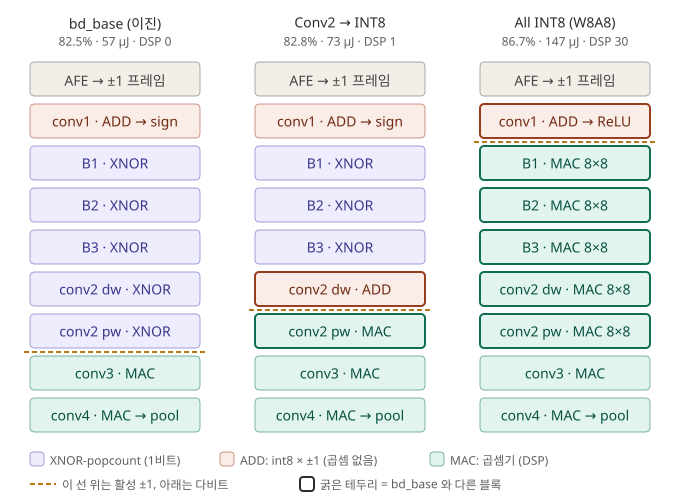
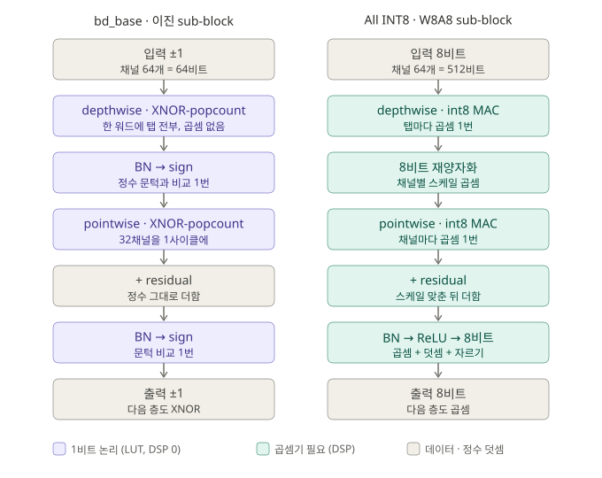

# 이진 vs int8 — `bd_base` / `bd_c2int8` / `bd_allint8` (2026-10-25, 완료)

**질문**: XNOR-popcount 이진화를 걷어내면 무엇을 얻고 무엇을 잃나. 첫 단계로
**conv2 하나만** int8 로 바꿔 본다 (CLAUDE.md §3.3 이 사전 등록한 ablation).

**답 (요약)** — 두 단계로 쟀고 답이 다르다.

| | 바꾼 곳 | test | `bd_base` 대비 | 하드웨어 (추정) |
|---|---|---:|---:|---|
| `bd_base` | — (지금 칩) | 0.8249 | — | 실측: 57.4 ms, ≈10.5 mJ |
| `bd_c2int8` | conv2 만 int8 | 0.8284 | **+0.35pp (잡음)** | 사이클 +22%, 메모리 +19% |
| `bd_allint8` | **B1–B3 + conv2** int8 가중치, 활성 float | 0.870 | +4.5pp | 사이클 ×2.2 (**10 Hz 미달**), 메모리 ×2 |
| **`bd_allint8_a8`** | 위 + **활성 8비트 (W8A8, 하드웨어 조건)** | **0.867** | **+4.2pp** | 같음 |

- **conv2 의 이진화는 공짜다** — 정확도를 안 내주고 하드웨어만 아낀다.
- **B1–B3 의 이진화는 공짜가 아니다** — W8A8 기준 **4.2pp** 를 내준다. 그 대가로 곱셈 ×4,
  사이클 ×2.2, 에너지 ×2 를 아낀다. 85% 목표는 int8 쪽만 넘는다.
- 정규화(§9.4)도, 활성 8비트(§9.5)도 int8 의 ~0.87 을 움직이지 않는다.
- 상세: conv2 는 §1–§8, B1–B3 는 **§9**, 한 장 정리는 **§10**.

> ⚠️ **실측과 추정을 구분한다.** `bd_base` 의 면적·전력·지연은 칩에서 잰 값이다.
> `bd_c2int8` 은 **export 가 막혀 있어** (`export/emit.py:225`, non-binary separable
> depthwise 거부) 비트스트림이 없다. 그쪽 하드웨어 숫자는 전부 **연산·비트 수에서
> 계산한 추정**이다 (CLAUDE.md §1: 전력은 연산 카운트 기반 추정으로 다룬다).

---

## 1. 무엇이 다른가

| | `bd_base` | `bd_c2int8` |
|---|---|---|
| conv2 정밀도 | **binary** | **int8** |
| conv2 구조 | separable (dw k=29 dil 2 → pw 1×1), 같음 | 같음 |
| dw → pw 사이 | BN → **sign** (pw 가 XNOR 이려면 ±1 입력 필요) | **없음** (dw 출력이 그대로 pw 로) |
| 나머지 전부 | 전단 `fixed` · `ste_clip=0.003` · `q=0.75` · 증강 없음 · 100에폭 · seed 1234 · 동료 보드 필터뱅크 | **같음** |

바뀐 변수가 하나라 차이는 전부 conv2 정밀도 탓이다.

```bash
python -m train.train --config configs/base.yaml --tag bd_c2int8 \
    afe.spice_matrix_path=analog/AFE/artifacts/filterbank_matrix_board.csv \
    model.stages.conv2.precision=int8
```

### 1.1 전체 구조에서 어디가 다른가

설계 원칙(CLAUDE.md §3.3)은 **"양 끝은 이진화하지 않고 가운데만 이진화한다"** 다.
Cerutti Fig.5 에서 입력·끝단 이진화가 정확도를 급락시켰기 때문이다.

| 층 | `bd_base` | `bd_c2int8` | 이렇게 정한 이유 |
|---|---|---|---|
| AFE | 16ch → ±1 프레임 | 같음 | |
| conv1 | int8 × ±1 | 같음 | 첫 층 이진화 금지. 입력이 ±1 이라 int8 이어도 곱셈 없이 부호 누산 |
| B1–B3 | XNOR-popcount | 같음 | 연산·파라미터 대부분 → 이진화 이득이 가장 큼 |
| **conv2 dw** | **XNOR-popcount** | **int8 × ±1** | 기본은 이진, int8 / dense 는 사전 등록 ablation |
| **conv2 pw** | **XNOR-popcount** | **int8 × 13비트 곱셈** | |
| conv3 | int8 × 다비트 곱셈 | 같음 | |
| conv4 → pool | 고정소수점 | 같음 | 마지막 층 이진화 금지 |

`bd_base` 의 conv2 는 **dw·pw 둘 다 XNOR-popcount** 다 (`manifest.json`: `conv2_dw`
= `binary_dw`, `conv2_pw` = `binary_pw`). 다만 이득의 크기가 다르다 (CLAUDE.md §3.4):

- **dw** 는 채널을 섞지 않는다. 한 채널의 29탭이 32비트 워드 하나에 들어가 **채널당 1사이클**.
  가장자리에서는 패딩 탭을 빼고 N 을 줄여야 해서 정렬 장치(`valid` 시프트)가 붙는다.
- **pw** 는 64채널이 그대로 워드 2개라 **출력당 2사이클**. 비트 팩킹 이득이 여기서 가장 크다.

이진 층은 모두 같은 방식으로 돈다: 내적 = `2·popcount(XNOR) − N`, BN 은 정수 문턱 하나로
접고, 비교 결과(±1)가 다음 층 입력이다. 그래서 **"활성이 ±1 인 구간 = 비교만 하는 세계"**,
그 아래가 **산술 세계**다.

**RTL 배치** (`rtl/kws_top.v`):

```
u_c1   kws_conv1     conv1
u_b1~3 kws_block     B1~B3  = kws_tcs_sub(kws_dw_conv + kws_pw_conv) x2 + skip
u_c2   kws_dw_conv   conv2 dw                                   ── ±1 출력
u_tail kws_tail      conv2 pw → affine → conv3 → affine → conv4 → affine → pool/argmax
```

`kws_tail` 이 **conv2 pw 부터** 시작하는 건 우연이 아니다. conv2 pw 는 **BN 이 문턱으로
접히지 않고 살아남는 첫 층**이고(다음 층 conv3 가 int8 이라 sign 이 아니라 ReLU),
그 지점이 비교가 끝나고 산술이 시작되는 경계다 (`kws_tail.v` 주석).

**int8 로 바꾸면 이 경계가 한 층 위, conv2 dw 와 pw 사이로 올라간다:**

```
              bd_base                         bd_c2int8
  B3      ±1 ─────────────               ±1 ─────────────
  conv2 dw  XNOR → 문턱 → ±1                int8 × ±1 → 13비트 그대로   ← 경계
  conv2 pw  XNOR → 정수 누산    ← 경계       (채널별 재스케일) → int8 × 13비트 곱셈
  conv3     int8 곱셈                       int8 곱셈
```

- **dw**: 입력이 여전히 B3 의 ±1 이라 곱셈은 없다. 다만 dw→pw 사이 BN → sign 이 없으므로
  출력이 **13비트 값 그대로** 나간다.
- **pw**: 그 값을 받으므로 `kws_pw_conv`(XNOR) 가 아니라 `kws_dense_conv` 형 곱셈이 된다.
- **사이**: dw 채널별 스케일이 달라 pw 앞에 채널별 재스케일(`kws_affine` 형)이 필요하다.

즉 RTL 로는 **conv2 dw 가 이진 엔진 쪽(`u_c2`)에서 꼬리 쪽(`u_tail`)으로 넘어가는 구조
변경**이다. 학습 쪽은 config 한 줄이지만 하드웨어에서는 경계선이 움직이는 일이고,
`emit.py` 가 이 경우를 거부하는 것도 같은 이유다.

---

## 2. 정확도 (Performance ①)

| | `bd_base` | `bd_c2int8` | 차이 |
|---|---:|---:|---:|
| **test, best.pt** | **0.8249** | **0.8284** | **+0.35pp** |
| test, 마지막 에폭 | — | 0.8310 | |
| best val (에폭) | 0.8364 (82) | 0.8476 (64) | +1.12pp |
| train − val (best 시점) | +1.2pp | +0.9pp | 둘 다 과소적합 |
| 정수 경로 정확도 | 0.833 (균형 1200 클립) | **없음** (export 불가) | |
| 칩 일치 | **600/600 × 2** | **없음** | |

- **+0.35pp 는 잡음이다.** test 약 4,890 클립에서 17개 정도이고 표준오차(~0.5pp)보다 작다.
  val 의 +1.1pp 는 100개 에폭 중 최고점이라 test 보다 낙관적이다.
- **seed 1개.** 학습이 결정적이라(같은 커맨드 두 번이 소수점 16자리까지 같았다) 재실행으로는
  잡음을 못 잰다. "차이 없음"을 주장으로 쓰려면 seed 를 바꿔 2개씩 더 돌린다.
- 비교: 입력 이진화를 끄면 +20pp (`fx_nobin`, 다른 축). conv2 의 1비트는 그에 비해 0 에
  가깝다. **단 B1–B3 의 1비트는 4.5pp 다 (§9)** — "손실은 입력에서만 난다"고 읽으면 안 된다.

---

## 3. 파라미터 · 비트 수

### 3.1 가중치 개수 — 같다

| 층 | 가중치 | `bd_base` | `bd_c2int8` |
|---|---:|---|---|
| conv1 | 22,528 | int8 | int8 |
| B1 | 22,976 | binary | binary |
| B2 | 10,112 | binary | binary |
| B3 | 10,368 | binary | binary |
| **conv2** (dw 1,856 + pw 8,192) | **10,048** | **binary** | **int8** |
| conv3 | 16,384 | int8 | int8 |
| conv4 | 1,536 | fixed 7b | fixed 7b |
| **합계** | **93,952** | | |

개수는 같고 **한 개당 비트 수**가 바뀐다. 이진 가중치 비중은 53,504 → 43,456 개
(전체의 57% → 46%).

학습 파라미터로는 int8 쪽이 **조금 적다**: dw 뒤의 BN(64채널, 학습값 128개)이 없다.

### 3.2 가중치 메모리 — +70,336 비트 (+18.7%)

| 층 | `bd_base` 비트 | `bd_c2int8` 비트 |
|---|---:|---:|
| conv1 (22,528 × 8) | 180,224 | 180,224 |
| B1–B3 (43,456 × 1) | 43,456 | 43,456 |
| **conv2** | **10,048** (× 1) | **80,384** (× 8) |
| conv3 (16,384 × 8) | 131,072 | 131,072 |
| conv4 (1,536 × 7) | 10,752 | 10,752 |
| **합계** | **375,552** (45.8 KiB) | **445,888** (54.4 KiB) |

conv2 혼자 **8배**가 되고, 네트워크 전체로는 +18.7%.

### 3.3 누산기 폭 (해석적 상한)

| | `bd_base` | `bd_c2int8` (추정) |
|---|---:|---:|
| conv2_dw | **6 비트** (±29) | **13 비트** (29 × 127 = ±3,683) |
| conv2_pw | **8 비트** (±64) | **~26 비트** (64 × 127 × 3,683, dw 출력을 그대로 넣을 때) |

### 3.4 저장 상수 (BN 융합 후)

| | `bd_base` | `bd_c2int8` |
|---|---|---|
| dw 뒤 | 정수 threshold 64 + 극성 64 (`conv2_dw_t`) | **채널별 재스케일 64 (gain + bias) 필요** — 아래 |
| pw 뒤 | affine 128 (`conv2_pw_bn`) | 같음 |

**숨은 비용**: int8 dw 는 출력 채널마다 가중치 스케일 `s_dw[c]` 가 다르다. pw 는 채널을
섞으므로 그 스케일을 pw 쪽으로 밀어낼 수 없다. 그래서 dw 와 pw 사이에 채널별 곱셈
(`kws_affine` 같은 것)이 하나 더 들어가야 한다. 이진 쪽은 같은 자리가 비교 한 번이다.

---

## 4. 연산 (클립 1회, 프레임 64개)

| | `bd_base` | `bd_c2int8` | 차이 |
|---|---:|---:|---:|
| XNOR-popcount 항 (1비트) | 3,424,256 | 2,781,184 | −643,072 |
| int8 × ±1 (곱셈 없는 부호 누산) | 1,441,792 (conv1) | 1,560,576 (+conv2_dw) | +118,784 |
| **다비트 곱셈-누산** | **1,146,880** (conv3, conv4) | **1,671,168** (+conv2_pw) | **+524,288 (+46%)** |
| 합계 | 6,012,928 | 6,012,928 | 0 |

**곱셈기가 생기는 건 pw 쪽뿐이다.** dw 는 입력이 B3 의 sign 출력(±1)이라 int8 이어도
conv1 처럼 더하기·빼기로 끝난다. pw 는 입력이 dw 의 13비트 출력으로 바뀌어 진짜 곱셈이 된다.

---

## 5. 지연 (Performance ②)

현재 RTL 의 처리 단위로 센다: 이진 MAC 은 32비트 워드 1개/사이클, int8·다비트 MAC 은
1항/사이클 (`kws_dense_conv`, `kws_conv1` 과 같은 방식으로 만든다고 가정).

| | `bd_base` | `bd_c2int8` (추정) |
|---|---:|---:|
| conv2_dw / 프레임 | ~64 (채널당 워드 1개) | 1,856 |
| conv2_pw / 프레임 | ~256 (출력당 워드 2개) | 8,192 |
| conv2 / 클립 | **~20,480** | **643,072** (×31) |
| **클립 전체** | **2.87 M** (실측) | **~3.49 M** (+22%) |
| 50 MHz 지연 | **57.4 ms** (실측) | **~69.9 ms** |
| 10 Hz(100 ms) 대비 여유 | 1.74 배 | 1.43 배 |

10 Hz 추론은 여전히 된다. 다만 conv2 한 층이 이진일 때보다 **31배** 느리다 —
이진화의 이득이 접은(folded) 설계에서는 **면적보다 사이클**로 나타난다.

---

## 6. 면적 (Area)

| 자원 | `bd_base` (실측, `u_net`) | `bd_c2int8` (추정) | 근거 |
|---|---:|---:|---|
| LUT | 20,047 | **+1,100 ~ 1,500** | 가중치 +70 Kbit 를 분산 ROM 에 두면 LUT6 당 64비트 ≈ 1,100 + 누산기·버퍼 |
| FF | 16,425 | **+~1,000** | dw 출력 프레임 버퍼 64 × 13비트, 넓은 누산기 |
| BRAM | RAMB18 6 | (가중치를 BRAM 에 두면 RAMB36 +2) | |
| DSP48E1 | 7 | **+1 ~ 2** | pw 곱셈기 1 + dw→pw 재스케일 1 |

**접은 설계라 면적 차이는 작다(~5~8%).** 곱셈기를 시분할로 1개만 쓰기 때문이다.
완전 펼친(unrolled) 설계라면 pw 128×64 개 곱셈이 그대로 면적이 되어 차이가 훨씬 커진다.

참고: `bd_base` 의 현재 최악 타이밍 경로가 바로 **conv2_dw 의 이진 MAC 입력 선택 →
누산기**다(WNS +4.96 ns, `selftest_report.md` §7.2). int8 로 바꾸면 이 경로 자체가
바뀌므로 타이밍은 만들어 봐야 안다.

---

## 7. 전력 · 에너지 (Power)

| | `bd_base` (vectorless) | `bd_c2int8` (추정) |
|---|---:|---:|
| Total on-chip | 0.184 W | ≈ 0.184 W + α |
| 그중 static | 0.094 W | 같음 |
| **클립당 에너지** | **≈ 10.5 mJ** | **≈ 12.8 mJ 이상** (+22%) |

- `bd_c2int8` 은 "전력은 거의 같고 시간이 22% 길다"로 계산했다. 칩 전력의 절반이 정적이라
  에너지는 대체로 **실행 시간**을 따라간다. DSP·ROM 이 늘어나는 동적 전력(α)은 빠져
  있으므로 **하한**이다.
- `bd_base` 값도 vectorless(기본 스위칭률 가정, 신뢰도 Medium)이고 하네스·클립 ROM 포함이다.
  SAIF 를 넣은 비교는 두 설계를 모두 만든 뒤에 의미가 있다.

---

## 8. 결론과 다음

| 축 | int8 로 바꾸면 |
|---|---|
| 정확도 | **변화 없음** (+0.35pp, 잡음) |
| 가중치 메모리 | conv2 ×8, 전체 +18.7% |
| 다비트 곱셈 | +46% |
| 지연 | conv2 ×31, 클립 +22% |
| 면적 | +5~8% (접은 설계라 작다) |
| 에너지 | +22% 이상 |

**conv2 의 XNOR-popcount 는 정확도를 내주지 않고 하드웨어만 아낀다.** 이 결과로 B1–B3 도
비슷할 거라고 예상했는데 **틀렸다** — §9 에서 B1–B3 는 4.5pp 를 냈다. 한 층의 결과로
나머지를 외삽하면 안 된다는 것이 이 실험의 두 번째 교훈이다.

남은 일 (필요할 때만):

1. **seed 2개씩 더** — "차이 없음"을 보고서 주장으로 쓸 때.
2. **실측 면적·전력** — `emit.py` 에 int8 dw 경로 + RTL 에 int8 dilated dw · dw→pw 재스케일 ·
   곱셈 pw. 그 뒤 두 설계를 같은 조건(네트워크 단독, SAIF)으로 잰다.

출처: `rtl/gen/bd_base/manifest.json`(층·가중치·누산기 폭), `docs/selftest_report.md` §7
(면적·타이밍·전력 실측), `rtl/kws_dense_conv.v`·`kws_pw_conv.v`·`kws_conv1.v` 주석
(사이클 단위), 원격 `runs/bd_c2int8/test.json`, `show_history --tag bd_base --tag bd_c2int8`.

---

## 9. B1–B3 까지: `bd_allint8` — XNOR 이 하나도 없는 네트워크

`Int8TCSBlock` (CLAUDE.md §3.3 결정 기록 2026-10-25, 비교 실험 전용). B1–B3 는
int8 dw → int8 pw → [+skip] → BN → **ReLU**, conv2 도 int8. conv1 은 다음 층이 int8 이라
sign 대신 ReLU 를 낸다. **바뀐 것은 가중치 정밀도 + 활성(±1 → 다비트) 둘 다**다.



점선은 활성이 ±1 에서 다비트로 바뀌는 지점이다. bd_base 는 conv2 pw 뒤, conv2-int8 은
conv2 dw 와 pw 사이, all-int8 은 conv1 바로 뒤. 굵은 테두리가 bd_base 와 다른 블록.



sub-block 하나를 열면: 이진은 dw 와 pw 사이에 **BN → sign** 이 있다 (pw 도 XNOR 이려면 ±1
입력이 필요). int8 은 그 BN 이 없고 8비트 재양자화만 있다 (MatchboxNet 원형). residual 은
이진이 popcount 정수에 그대로, int8 은 두 경로 스케일을 맞춘 뒤 더한다. 하드웨어 차이의
대부분은 **pw** — 이진은 32채널/사이클, int8 은 채널마다 곱셈 1번 (§9.6).

```bash
python -m train.train --config configs/base.yaml --tag bd_allint8 \
    afe.spice_matrix_path=analog/AFE/artifacts/filterbank_matrix_board.csv \
    model.stages.b1.precision=int8 model.stages.b2.precision=int8 \
    model.stages.b3.precision=int8 model.stages.conv2.precision=int8
```

### 9.1 정확도

| | `bd_base` | `bd_c2int8` | **`bd_allint8`** |
|---|---:|---:|---:|
| **test, best.pt** | 0.8249 | 0.8284 | **0.870** |
| test, 마지막 에폭 | — | 0.8310 | 0.857 |
| best val (에폭) | 0.8364 (82) | 0.8476 (64) | **0.878 (20)** |
| train (best 시점) | 0.849 | 0.857 | 0.941 |
| train − val (best 시점) | +1.2pp | +0.9pp | **+6.3pp** |
| 마지막 에폭 train / val | 0.845 / 0.828 | 0.856 / 0.835 | **0.988 / 0.862** |

**+4.5pp 는 잡음이 아니다** (test 약 220 클립, 표준오차 ~0.5pp 의 9배).

**성격이 정반대로 바뀐다.** 이진 모델 둘은 **과소적합**(train 이 85% 근처에서 막히고
val 과 1pp 차)인데, int8 은 train 이 98.8% 까지 올라가는 **과적합**이다. 즉 이진 B1–B3 의
병목은 **용량**이었고 int8 이 그걸 풀었다. 그래서:

- best.pt 가 **에폭 20**(첫 학습률 하강 직후)이다. 그 뒤로 train 은 오르고 val 은 내려간다.
  0.870 은 **정규화(dropout · weight_decay · label smoothing) 가 전부 0 인 상태**의 값이라,
  int8 은 정규화를 넣으면 더 오를 여지가 있다. 이진 쪽은 과소적합이라 그 여지가 없다.
- ⚠️ **상한으로 읽는다.** 학습에서 int8 은 **가중치만** 양자화하고 활성은 float 다.
  하드웨어는 활성도 고정소수점으로 잘라야 하므로 실제 칩에서는 이보다 낮다. 얼마나 낮은지는
  활성 양자화를 넣어 다시 학습해야 안다.
- seed 1개.

### 9.2 하드웨어 (추정 — §3~§7 과 같은 방식)

| | `bd_base` | `bd_c2int8` | **`bd_allint8`** |
|---|---:|---:|---:|
| 가중치 개수 | 93,952 | 93,952 | 93,952 |
| 이진 가중치 | 53,504 | 43,456 | **0** |
| **가중치 메모리** | 375,552 b | 445,888 b (+19%) | **750,080 b (×2.0)** |
| XNOR-popcount 항 / 클립 | 3,424,256 | 2,781,184 | **0** |
| int8 × ±1 (곱셈 없음) | 1,441,792 | 1,560,576 | 1,441,792 (conv1 만) |
| **다비트 곱셈 / 클립** | 1,146,880 | 1,671,168 (+46%) | **4,571,136 (×4.0)** |
| **클립당 사이클** | 2.87 M (실측) | ~3.49 M | **~6.17 M (×2.15)** |
| **50 MHz 지연** | 57.4 ms | ~69.9 ms | **~123 ms** |
| **10 Hz (100 ms)** | ✅ 여유 1.74배 | ✅ 1.43배 | ❌ **미달 (0.81배)** |
| 클립당 에너지 | ≈ 10.5 mJ | ≈ 12.8 mJ+ | **≈ 22.6 mJ+** |
| LUT (가중치 ROM 증가분) | 20,047 | +~1,100 | **+~5,900** (분산 ROM 64 b/LUT 기준) |
| DSP48E1 | 7 | 8~9 | **~30** (MAC 15 + 재스케일·BN) |

계산 근거:

- **곱셈이 4배인 이유**: conv1 이 ReLU 를 내면서 **B1 부터 모든 층의 입력이 다비트**가 된다.
  conv1 만 입력이 AFE 의 ±1 이라 여전히 곱셈이 없다.
- **사이클**: 이진 B1–B3 + conv2 는 워드 팩킹으로 프레임당 ~1,920 사이클(클립당 ~0.12 M)
  이던 것이, 1항/사이클이면 클립당 3.42 M 이 된다. 2.87 − 0.12 + 3.42 ≈ 6.17 M.
- **10 Hz 미달**: 지금 RTL 처럼 층마다 MAC 1개를 직렬로 돌리면 못 맞춘다. 맞추려면 무거운
  층에 MAC 을 2개 이상 두거나 클럭을 올려야 하고(Fmax 추정 ~66 MHz → 94 ms, 빠듯), 그게
  면적 비용이다. **이진화가 사이클로 아끼던 것이 여기서 면적으로 청구된다.**
- **에너지**: "전력 같고 시간이 2.15배" — DSP·ROM 증가분 동적 전력이 빠진 **하한**.
- 면적·DSP 는 미구현 설계의 어림이다. `emit.py`/`golden.py` 가 이 모델을 거부하므로
  실측하려면 RTL 이 새로 필요하다(int8 dw · pw · 재스케일 affine 을 층마다).

### 9.3 무엇을 고를 것인가

| | 이진 (`bd_base`) | 비이진 (`bd_allint8`) |
|---|---|---|
| 정확도 | 0.825 — 85% **미달** | 0.867 (W8A8) — 85% **통과** |
| 10 Hz 실시간 | ✅ MAC 1개로 | ❌ MAC 을 늘려야 |
| 메모리 / 곱셈 / 에너지 | 1 / 1 / 1 | ×2 / ×4 / ×2+ |
| 칩 검증 | **600/600 × 2** | 없음 (RTL 없음) |

트레이드오프가 처음으로 숫자가 됐다: **B1–B3 이진화는 4.5pp 로 곱셈 3/4, 사이클 절반,
에너지 절반을 산다.** 85% 를 꼭 넘어야 한다면 그 가격을 내야 하고, 하드웨어 효율이 목표라면
이진이 맞다.

다음에 할 만한 것 (필요할 때만):

1. ~~**int8 에 활성 양자화**~~ — 해봤다. 0.870 → **0.867**, 거의 안 내려온다 (§9.5).
2. **이진 쪽 용량** — 이진은 과소적합이므로 `model.C=96` 같은 폭 증가가 4.5pp 를 얼마나
   되찾는지. XNOR 를 유지한 채 격차를 줄이는 방향이다 (CLAUDE.md §1 의 원래 마일스톤).
3. ~~**int8 정규화**~~ — 해봤다. **상한은 안 오른다** (§9.4).
4. seed 2개씩 — 보고서 주장으로 쓸 때.

### 9.4 정규화로 상한이 오르나 — 안 오른다 (2026-10-25)

`bd_allint8` 이 과적합이었으므로 정규화를 **하나씩만** 켰다. 나머지는 `bd_allint8` 과 같다.
weight decay 는 먼저 `train/train.py` 를 고쳐 **AFE 임계값(=R7/R8)에는 걸리지 않게** 했다
(`7c374eb`) — 안 그러면 네트워크가 아니라 아날로그 전단을 0 쪽으로 끈다.

| 태그 | 켠 것 | **test (best.pt)** | test (마지막) | best val (에폭) | train−val (best) | 마지막 train / val |
|---|---|---:|---:|---:|---:|---|
| `bd_allint8` | — | **0.8701** | 0.8570 | 0.8785 (20) | +6.2pp | 0.988 / 0.863 |
| `bd_allint8_do10` | dropout 0.1 (B1–B3, conv2) | **0.8711** | **0.8713** | 0.8857 (40) | +6.0pp | **0.961 / 0.878** |
| `bd_allint8_wd1e4` | weight decay 1e-4 | **0.8652** | 0.8547 | 0.8848 (21) | +5.8pp | 0.988 / 0.863 |
| `bd_allint8_ls01` | label smoothing 0.1 | **0.8693** | 0.8580 | 0.8825 (24) | +7.3pp | 0.990 / 0.875 |

**test 는 +0.1 / −0.5 / −0.1pp — 전부 잡음 안이다** (표준오차 ~0.5pp, seed 1개).

- **val 은 셋 다 올랐는데 (+0.4~0.7pp) test 는 안 올랐다.** best val 은 100개 에폭 중
  최고점이라 낙관적이고, 그 차이는 test 로 옮겨가지 않았다. val 만 보고 "정규화가 듣는다"고
  읽으면 안 된다.
- **dropout 은 봉우리를 높이지 않고, 봉우리 뒤의 하락을 없앤다.** 마지막 에폭 test 가
  0.857 → **0.871** 로 best 와 같아졌고, train 이 0.988 → 0.961 로 덜 외운다. 즉 체크포인트를
  어디서 고르든 같은 값이 나온다 — 정확도는 그대로지만 **결과가 안정적**이 된다.
- weight decay · label smoothing 은 봉우리도, 하락도 못 바꿨다.
- **best 에폭이 넷 다 첫 학습률 하강 직후다** (20 / 40 / 21 / 24). 과적합 런은 val loss 가
  일찍 오르기 시작해 plateau 스케줄러가 일찍 학습률을 내리고, 그 직후가 봉우리다.
  정규화보다 스케줄이 봉우리 위치를 정하고 있다 (관찰, 미검증).

**결론: int8 의 ~0.87 은 정규화로 안 움직인다.** 이 강도(dropout 0.1, wd 1e-4, ls 0.1)에서는
그렇다 — 값마다 한 점씩만 쟀으므로 더 강한 dropout 이 듣지 않는다고까지는 말할 수 없다.
그래서 이진 대 int8 격차는 **~4.5pp 그대로**다(0.825 대 0.870~0.871).

가설(미검증): int8 쪽의 다음 병목은 네트워크가 아니라 **입력 1비트**일 수 있다. 같은 전단에서
입력 이진화를 끄면 +20pp 였다(`fx_nobin` 0.917, 이진 네트워크·옛 전단 조건이라 직접 비교는
안 된다).

### 9.5 활성도 8비트로 — W8A8 (`bd_allint8_a8`, 2026-10-25)

§9.1–§9.4 의 int8 은 **가중치만** 양자화했고 활성은 float 였다(상한). `model.act_bits=8`
(`a572dc5`)로 다비트 활성을 전부 8비트로 자른다: ReLU 출력은 부호 없이 0~255,
dw→pw 사이 원출력은 부호 있게 ±127. 스케일은 텐서마다 EMA(max)/qmax, 평가 때 고정.
나머지는 `bd_allint8` 과 같다.

| 태그 | 활성 | **test (best.pt)** | test (마지막) | best val (에폭) | train−val (best) |
|---|---|---:|---:|---:|---:|
| `bd_allint8` | float | 0.8701 | 0.8570 | 0.8785 (20) | +6.2pp |
| **`bd_allint8_a8`** | **8비트** | **0.8668** | 0.8511 | 0.8809 (21) | +7.1pp |

**−0.33pp — 잡음 안이다.** 활성 8비트는 정확도를 거의 안 깎는다. 그래서 int8 쪽의 하드웨어
조건 정확도는 **~0.867** 이고, 이진(`bd_base` 0.825)과의 격차는 **4.2pp** 로 확정한다.
학습 곡선의 모양(에폭 ~20 봉우리, 이후 과적합)도 같다.

남은 차이: 이건 학습 중 fake-quant 다. 실제 정수 하드웨어는 층 사이 재스케일을 고정소수점
곱으로 해야 하고 그 반올림이 더 붙는다 — `bd_base` 의 꼬리가 float 0.825 → 정수 경로
(균형 세트) 0.833 으로 거의 안 변했던 것을 보면 작을 것이다. 확인하려면 export·RTL 이 필요하다.

---

### 9.6 빌딩블록 실측 — MAC 마이크로벤치 (2026-10-30, T470, Vivado)

§9.2 의 하드웨어 수치는 연산 수에서 계산한 추정이었다. int8 네트워크는 export·RTL 이
없어 통째로 합성할 수 없으므로, **MAC 하나**를 같은 칩(xc7s75-1, 50 MHz)에 배치배선해
항 하나의 비용을 재고 연산 수에 곱한다 (`rtl/bench/bench_mac.v`, `run_mac_bench.tcl`).

```powershell
vivado -mode batch -source rtl/bench/run_mac_bench.tcl -notrace            # KIND 0-5
vivado -mode batch -source rtl/bench/run_mac_bench.tcl -notrace -tclargs 6 7
```

입력은 내부 xorshift 로 만들고(모든 KIND 같은 자극), 자극만 있는 KIND 5 를 빼서 엔진만의
값을 낸다. 전력은 **vectorless** — KIND 끼리 비교용이고 절대값은 측정이 아니다.

| 구성 | 항/사이클 | LUT | FF | DSP | WNS (ns) | 엔진 동적 전력 | **pJ/항** |
|---|---:|---:|---:|---:|---:|---:|---:|
| `bin32` — 설계의 `kws_bin_mac` | 32 | 173 | 49 | 0 | 9.08 | 3.0 mW | 1.90 * |
| **`bin32x8`** — 위 8개 | 256 | 707 | 336 | 0 | 8.57 | 15.0 mW | **1.19** |
| `int8pm1x32` — int8 × ±1 (conv1 방식) | 32 | 1,050 | 775 | 0 | 9.94 | 24.0 mW | 15.2 |
| **`int8x32_dsp`** — int8 × int8, DSP | 32 | 1,042 | 787 | **32** | 12.03 | 43.0 mW | **27.3** |
| `int8x32` = `int8x32_lut` — LUT 곱셈 | 32 | 3,646 | 786 | 0 | 8.69 | 61.0 mW | 38.7 |
| `int8x1` — int8 MAC 1개 | 1 | 109 | 31 | 0 | 11.15 | 1.0 mW | 20 * |

\* report_power 의 요약이 1 mW 단위라 3 mW·1 mW 는 ±17%·±50% 가 걸린다. 그래서 이진은
8개 묶음(15 mW)의 **1.19 pJ** 를 쓴다. 8개 묶음의 LUT 가 하나당 88 로 단독(173)보다 작은
것은 같은 시작·길이 신호를 받는 제어 로직을 Vivado 가 합쳤기 때문이다 — 층마다 MAC 이 따로
있는 실제 설계는 173 쪽이다. 첫 실행에서 `int8x32` 가 DSP 0개로 `int8x32_lut` 와 같았다
(8×8 곱셈은 기본으로 LUT 에 간다). 실제 int8 설계는 DSP48 을 쓸 것이므로 `int8x32_dsp` 가
공정한 int8 점이다.

**같은 처리량에서**: int8(DSP) 은 이진보다 **LUT 6배 + DSP 32개, 항당 에너지 23배**.

**네트워크 연산 에너지** (클립당, 연산 수 §9.2 × 위 pJ/항, 다비트 곱셈은 DSP 값):

| | 이진 `bd_base` | int8 W8A8 |
|---|---:|---:|
| XNOR (B1–B3, conv2) | 342만 × 1.19 = **4.1 µJ** | — |
| conv1 (int8 × ±1) | 144만 × 15.2 = 21.9 µJ | 21.9 µJ |
| 다비트 곱셈 | 115만 × 27.3 = 31.3 µJ | 457만 × 27.3 = **124.8 µJ** |
| **합계** | **≈ 57 µJ** | **≈ 147 µJ (2.6×)** |

- 이진 모델에서 **이진화된 층의 몫은 7% 뿐**이다 — 나머지는 이진화하지 않은 conv1 과
  꼬리(conv3/conv4). 항당 23배가 네트워크로는 2.6배가 되는 이유다.
- FPGA 에서는 이 연산 에너지가 작은 몫이다: 칩 클립당 ≈ 10.5 mJ 의 대부분은 정적 전력
  (0.094 W × 57 ms ≈ 5.4 mJ). FPGA 에서 두 모델의 에너지 차이는 연산보다 **실행 시간**에서
  나온다. 연산 에너지 비교가 의미 있는 곳은 ASIC 이다.
- 빠진 것: 가중치·평면 메모리 읽기, 제어, 꼬리의 실제 폭(int8 × 14비트 > 8×8). 이진 쪽에
  유리하게 빠진 것도 int8 쪽에 유리하게 빠진 것도 있다.

**DSP 예산 — 이번 측정이 새로 보여준 것.** 지금 설계의 이진 MAC 엔진은 15개(B1 5, B2 4,
B3 4, conv2 2)다. int8 로 바꾸며 지연을 지키려면 엔진마다 int8 MAC 이 필요하다:

| int8 엔진당 DSP | 총 DSP (칩 140) | 클립당 사이클 | 50 MHz 지연 | 10 Hz |
|---:|---:|---:|---:|---|
| 1 | 15 | ~6.2 M | ~123 ms | ❌ |
| 2 | 30 | ~4.5 M | ~89 ms | ✅ 빠듯 |
| 4 | 60 | ~3.6 M | ~72 ms | ✅ |
| 32 (이진과 같은 속도) | **480** | ~2.9 M | ~57 ms | **칩에 안 들어감** |

이진 모델은 이 층들을 **DSP 0개로 57 ms** 에 처리한다. int8 은 10 Hz 에 DSP 30~60개가
필요하고, 같은 속도는 이 칩으로 낼 수 없다. (사이클은 이진 층 몫 ~0.12 M 을 int8 3.42 M /
엔진당 DSP 로 바꿔 넣은 어림이다.)

## 10. 한 장 정리

논문용 표(IEEE, booktabs): [`paper/table_binarization.tex`](paper/table_binarization.tex)
· 미리보기 [`paper/table_binarization.png`](paper/table_binarization.png)
· 생성 `python docs/paper/make_table_binarization.py`. 그림은 §9 의 두 SVG.

| | 이진 (`bd_base`) | int8 W8A8 (`bd_allint8_a8`) |
|---|---|---|
| **정확도 (test)** | **0.825** — 85% 미달 | **0.867** — 85% 통과 (+4.2pp) |
| XNOR-popcount 층 | B1–B3, conv2 | 없음 |
| 가중치 메모리 | 375,552 b (45.8 KiB) | 750,080 b (×2.0) |
| 다비트 곱셈 / 클립 | 1.15 M | 4.57 M (×4.0) |
| 클립당 사이클 · 50 MHz 지연 | 2.87 M · **57.4 ms (실측)** | ~6.17 M · ~123 ms (추정) |
| 10 Hz 실시간 (MAC 1개/층) | ✅ 여유 1.74배 | ❌ 0.81배 — MAC 을 늘려야 |
| 클립당 에너지 (칩 전체) | ≈ 10.5 mJ (vectorless) | ≈ 22.6 mJ 이상 (추정) |
| 클립당 **연산** 에너지 (§9.6, MAC 실측 × 연산 수) | ≈ 57 µJ | ≈ 147 µJ (2.6×) |
| 같은 처리량의 MAC (§9.6) | 173 LUT, 0 DSP, 1.2 pJ/항 | 1,042 LUT + 32 DSP, 27.3 pJ/항 |
| 10 Hz 에 필요한 DSP (§9.6) | 0 (이진 층) | 30~60 (같은 속도면 480 — 칩 140 초과) |
| 칩 검증 | **600/600 × 2** | 없음 (export 불가) |

**알게 된 것**

1. **이진화 비용은 층마다 다르다.** conv2 는 0, B1–B3 는 4.2pp. 한 층의 결과로 나머지를
   외삽하면 틀린다 (실제로 그렇게 예상했다가 틀렸다).
2. **이진 B1–B3 의 병목은 용량이다.** 이진은 과소적합(train ≈ val ≈ 0.85), int8 은
   과적합(train 0.99). 정규화는 int8 의 봉우리를 못 올린다 (§9.4).
3. **int8 의 ~0.87 은 활성 8비트로도 유지된다** (§9.5). 하드웨어 조건에서도 이 격차는 진짜다.
4. **이진화가 아끼는 것은 접은 설계에서 사이클(→ 실시간·에너지)이다.** 면적이 아니다.
   int8 로 10 Hz 를 맞추려면 그 사이클을 MAC 병렬화(면적)로 사야 한다.

**가설 (미검증)**: int8 이 ~0.87 에서 멈추는 이유는 네트워크가 아니라 **입력 정보량** —
16채널 × 1비트 — 일 가능성이 크다. 입력 이진화를 끄면 +20pp(`fx_nobin` 0.917, 이진
네트워크·옛 전단이라 직접 비교 불가)였고, Cerutti 의 채널 수 곡선(8ch 76.3% → 64ch 86.0%)도
같은 방향이다. 확인하려면 int8 네트워크에서 채널 수나 입력 비트를 바꿔 봐야 한다.

**실측이 아닌 것**: int8 네트워크 통째의 하드웨어 수치(§3~§7, §9.2) — MAC 하나는 §9.6 에서
실측했고 네트워크는 그 값 × 연산 수다. 전력은 전부 vectorless. seed 는 전 런 1개씩.
